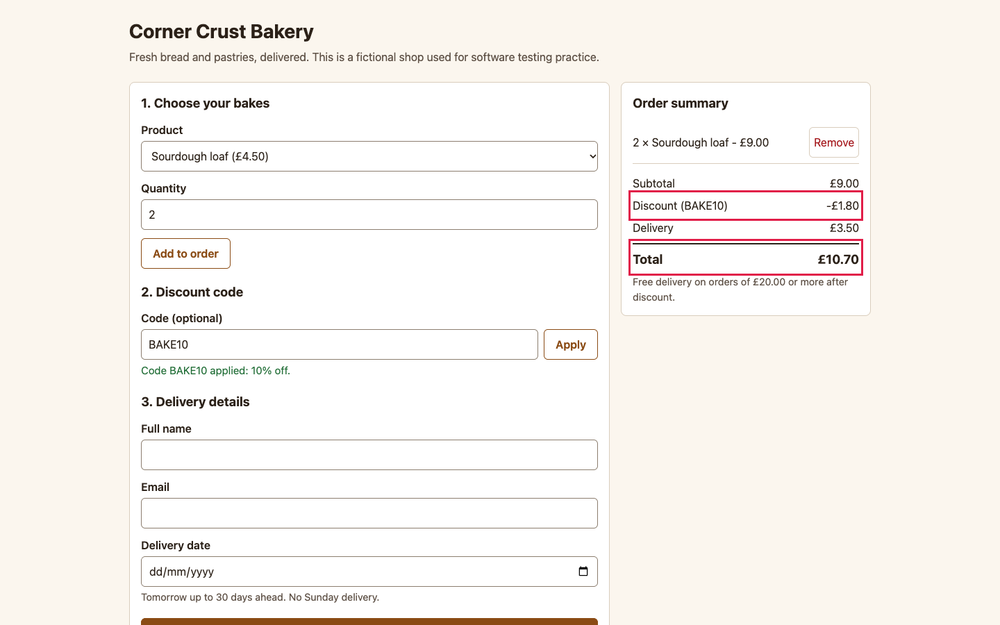
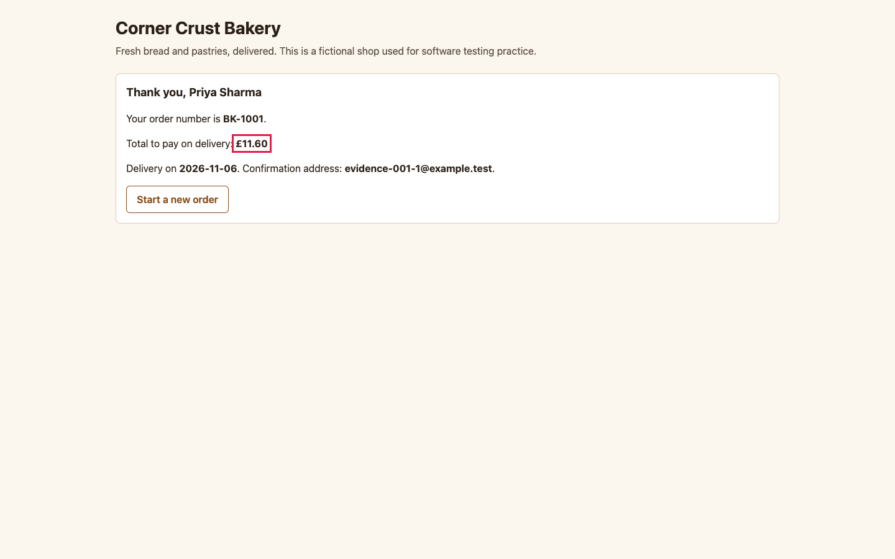

# BUG-001: Pressing Apply twice stacks the discount: summary shows 20% off, confirmation charges 10%

| Field | Value |
|---|---|
| ID | BUG-001 |
| Status | Confirmed (planted in the buggy build; not fixed) |
| Severity | S2 Major |
| Priority (suggested) | P1 |
| Area | Pricing and discount codes |
| Build | qa-report-kit 0.1.0, `app-buggy/` build (`npm run serve:buggy`, http://127.0.0.1:4173/) |
| Environment | Google Chrome 156.0.8078.76 (headless) on macOS; viewport 1440 x 900; locale en-GB, time zone Europe/London; browser clock and server date fixed to Wednesday 2026-11-04 |
| Found by | Regression case TC-011 failed on the buggy build, then reproduced by hand-written steps in a script (3 of 3 attempts) |
| Reproducibility | 3 of 3 attempts, each in a fresh browser context |

## Summary

Pressing **Apply** more than once adds the code's percentage again each time. The order summary then shows a bigger discount than the shop will give, and the confirmation shows a different total from the one the customer saw before ordering.

## Preconditions

None. Fresh page, empty order. Steps that name a date assume today is Wednesday 04/11/2026 (the fixed date of the test environment); on another day, count dates from today instead.

## Steps to reproduce

1. Open the order page.
2. Choose **Sourdough loaf**, set **Quantity** to `2` and press **Add to order**. The summary shows subtotal 9.00 and total 12.50.
3. Type `BAKE10` in **Code (optional)** and press **Apply**. The summary shows discount -0.90 and total 11.60 (correct so far).
4. Press **Apply** a second time (people often do this when nothing seems to happen).
5. Read the **Discount** and **Total** lines in the order summary.
6. Fill in name `Priya Sharma`, email `evidence-001@example.test`, delivery date `06/11/2026` and press **Place order**.
7. Read the total on the confirmation.

## Expected result

After step 4 the discount is still -0.90 and the total still 11.60: a code is applied once (rule R-3). The confirmation total equals the total in the summary (rule R-8).

## Actual result

After step 4: **Discount -£1.80**, **Total £10.70** (a second 10% was added, so 20% off). The confirmation in step 7 says **£11.60**, because the server applies the code once. The page promised £10.70 and then showed £11.60.

## Evidence

*Order summary after pressing Apply twice. The red outline marks the discount line and the total.*

*Confirmation for the same order: total £11.60.*

Red outlines were added to the screenshot by the capture script (`npm run evidence`) to point at the problem; the app does not draw them.

## Impact

Every customer who presses Apply twice sees a wrong price before ordering. The shop does not lose money (the server charges the correct amount), but the customer sees a higher total after the order than before it, which causes complaints and abandoned orders. Pressing Apply once avoids it.

## Notes

Pressing Apply three times shows 30% off. An unknown code resets the discount, so that path is not affected. The stored order is correct (subtotal 900, discount 90, total 1160), so the fault is in the page only. Related test cases: TC-011.
