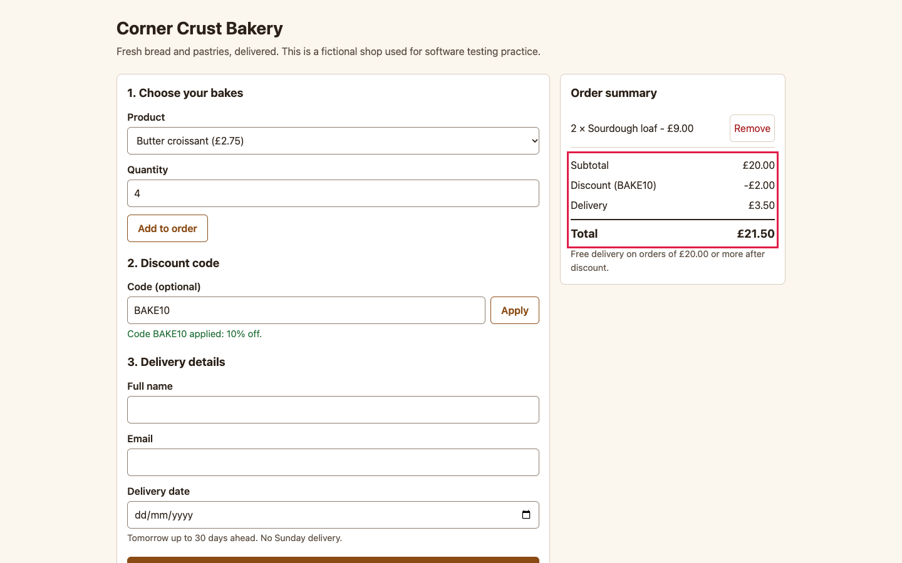

# BUG-002: Removing an item leaves the order summary totals unchanged

| Field | Value |
|---|---|
| ID | BUG-002 |
| Status | Confirmed (planted in the buggy build; not fixed) |
| Severity | S2 Major |
| Priority (suggested) | P1 |
| Area | Order summary |
| Build | qa-report-kit 0.1.0, `app-buggy/` build (`npm run serve:buggy`, http://127.0.0.1:4173/) |
| Environment | Google Chrome 156.0.8078.76 (headless) on macOS; viewport 1440 x 900; locale en-GB, time zone Europe/London; browser clock and server date fixed to Wednesday 2026-11-04 |
| Found by | Regression case TC-070, TC-071, TC-072 failed on the buggy build, then reproduced by hand-written steps in a script (3 of 3 attempts) |
| Reproducibility | 3 of 3 attempts, each in a fresh browser context |

## Summary

After pressing **Remove** on a line, the line disappears from the summary but subtotal, discount, delivery and total keep showing the old figures.

## Preconditions

None.

## Steps to reproduce

1. Open the order page.
2. Add **Sourdough loaf**, quantity `2`.
3. Add **Butter croissant**, quantity `4`. Subtotal is 20.00.
4. Apply code `BAKE10`. The total is 21.50 (20.00 - 2.00 discount + 3.50 delivery).
5. In the order summary press **Remove** next to *4 x Butter croissant*.
6. Read the lines and the totals in the order summary.

## Expected result

Only *2 x Sourdough loaf - 9.00* remains and the totals follow: subtotal 9.00, discount -0.90, delivery 3.50, total 11.60 (rule R-8).

## Actual result

The croissant line is gone, but the totals still read subtotal 20.00, discount -2.00, delivery 3.50, **total 21.50**. Removing the last item leaves the same stale figures next to "Your order is empty." The totals only refresh when something else is changed (for example adding another item).

## Evidence

*Summary after removing the croissants. One line is left, but the totals are still those of the full basket (outlined).*

Red outlines were added to the screenshot by the capture script (`npm run evidence`) to point at the problem; the app does not draw them.

## Impact

The customer is shown a price for goods they have removed. If they place the order the server works out the right total, so the confirmation then disagrees with the page, as in BUG-001. There is no workaround except reloading the page or adding another item.

## Notes

The same fault makes the delivery fee wrong when removing an item should bring back (or drop) the 3.50 fee. Related: BUG-001. Related test cases: TC-070, TC-071, TC-072.
