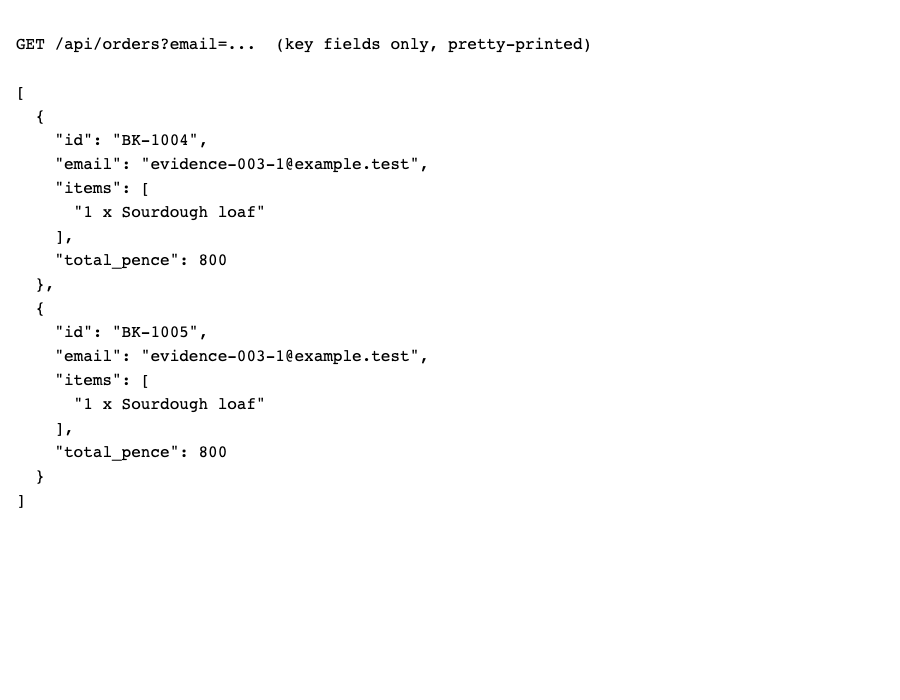

# BUG-003: Double-clicking Place order creates two orders

| Field | Value |
|---|---|
| ID | BUG-003 |
| Status | Confirmed (planted in the buggy build; not fixed) |
| Severity | S2 Major |
| Priority (suggested) | P1 |
| Area | Placing the order |
| Build | qa-report-kit 0.1.0, `app-buggy/` build (`npm run serve:buggy`, http://127.0.0.1:4173/) |
| Environment | Google Chrome 156.0.8078.76 (headless) on macOS; viewport 1440 x 900; locale en-GB, time zone Europe/London; browser clock and server date fixed to Wednesday 2026-11-04 |
| Found by | Regression case TC-060, TC-061 failed on the buggy build, then reproduced by hand-written steps in a script (3 of 3 attempts) |
| Reproducibility | 3 of 3 attempts, each in a fresh browser context |

## Summary

Two quick clicks on **Place order** send the order twice, and the shop receives two identical orders. The button is also not disabled while the order is being sent.

## Preconditions

None. Steps that name a date assume today is Wednesday 04/11/2026 (the fixed date of the test environment); on another day, count dates from today instead.

## Steps to reproduce

1. Open the order page.
2. Add one **Sourdough loaf** (quantity `1`).
3. Fill in name `Priya Sharma`, email `evidence-003@example.test` and delivery date `06/11/2026`.
4. Double-click **Place order** (two clicks within a fraction of a second).
5. Wait for the confirmation.
6. Request `/api/orders?email=evidence-003@example.test` (the app's order list, used by testers).

## Expected result

One order is created. The button is disabled and reads "Placing order..." as soon as the first click is accepted (rule R-9).

## Actual result

The order list for that address contains **two** orders with consecutive numbers and the same contents. The second click is accepted because the button stays enabled until the first reply arrives (the test server takes about 150 ms to answer; a slow connection leaves a longer window). While the request is pending the button is enabled and the page does not guard against a second send.

## Evidence

*The app's order list for the test address after one double-click: two orders (key fields only, pretty-printed for readability).*

Red outlines were added to the screenshot by the capture script (`npm run evidence`) to point at the problem; the app does not draw them.

## Impact

Two bakes and two deliveries for one order; the customer is billed twice on delivery. Likely on slow connections or with impatient users. Workaround for the customer: click once and wait.

## Notes

Reproduced by script with `dblclick`. A real double-tap on a phone should behave the same, but that was not tried on a device. Related test: TC-065 (second submit from a script while sending). Related test cases: TC-060, TC-061.
