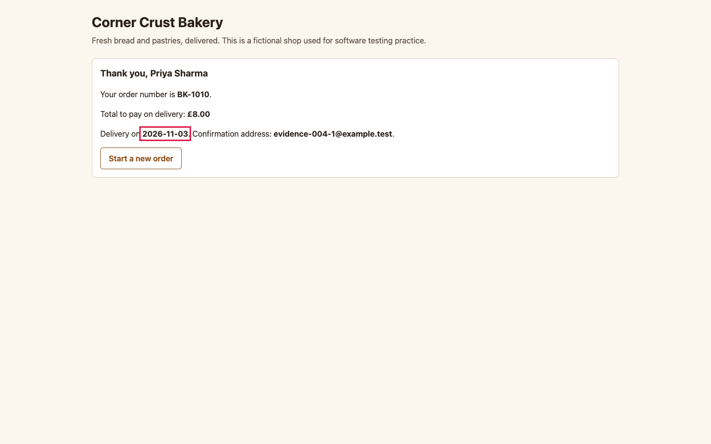

# BUG-004: Delivery dates in the past, including today, are accepted

| Field | Value |
|---|---|
| ID | BUG-004 |
| Status | Confirmed (planted in the buggy build; not fixed) |
| Severity | S2 Major |
| Priority (suggested) | P1 |
| Area | Delivery date validation |
| Build | qa-report-kit 0.1.0, `app-buggy/` build (`npm run serve:buggy`, http://127.0.0.1:4173/) |
| Environment | Google Chrome 156.0.8078.76 (headless) on macOS; viewport 1440 x 900; locale en-GB, time zone Europe/London; browser clock and server date fixed to Wednesday 2026-11-04 |
| Found by | Regression case TC-030, TC-035, TC-101 failed on the buggy build, then reproduced by hand-written steps in a script (3 of 3 attempts) |
| Reproducibility | 3 of 3 attempts, each in a fresh browser context |

## Summary

The order form and the server accept a delivery date of yesterday or today. The bakery needs at least one day's notice (rule R-6), so these orders cannot be fulfilled.

## Preconditions

None. Today's date in the test environment is Wednesday 2026-11-04. Steps that name a date assume today is Wednesday 04/11/2026 (the fixed date of the test environment); on another day, count dates from today instead.

## Steps to reproduce

1. Open the order page.
2. Add one **Sourdough loaf**.
3. Fill in name `Priya Sharma` and email `evidence-004@example.test`.
4. In **Delivery date** enter `03/11/2026` (yesterday).
5. Press **Place order**.
6. Repeat with `04/11/2026` (today), and by posting the same date straight to `POST /api/orders`.

## Expected result

The page shows "Delivery must be at least one day ahead. Choose tomorrow or later." under the date field and no order is created. The server answers 422 to the direct request.

## Actual result

The order is accepted and the confirmation says **Delivery on 2026-11-03**, one day before today. Today's date is accepted too, and so is any date up to a year back. The server accepts them as well, so skipping the page does not help.

## Evidence

*Confirmation for an order with a delivery date of 2026-11-03. The delivery date is outlined.*

Red outlines were added to the screenshot by the capture script (`npm run evidence`) to point at the problem; the app does not draw them.

## Impact

Orders that cannot be delivered are accepted and confirmed to the customer, which the shop then has to cancel by hand. Anyone can trigger it by mistyping the date, and the date picker's limits do not stop typed dates.

## Notes

The picker's `min` attribute is set correctly, but typing a date overrides it, so the check has to be in the validation, which is where it is missing. Both the page and the server share the faulty rule. Related test cases: TC-030, TC-035, TC-101.
