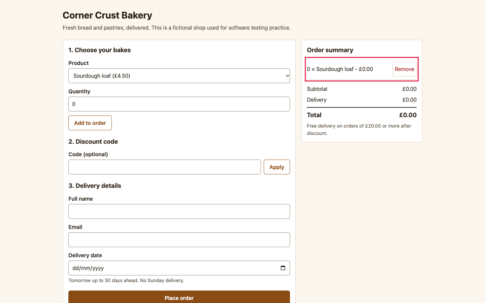

# BUG-005: Quantity 0 is accepted and adds a free line to the order

| Field | Value |
|---|---|
| ID | BUG-005 |
| Status | Confirmed (planted in the buggy build; not fixed) |
| Severity | S3 Minor |
| Priority (suggested) | P2 |
| Area | Quantity validation |
| Build | qa-report-kit 0.1.0, `app-buggy/` build (`npm run serve:buggy`, http://127.0.0.1:4173/) |
| Environment | Google Chrome 156.0.8078.76 (headless) on macOS; viewport 1440 x 900; locale en-GB, time zone Europe/London; browser clock and server date fixed to Wednesday 2026-11-04 |
| Found by | Regression case TC-020, TC-036 failed on the buggy build, then reproduced by hand-written steps in a script (3 of 3 attempts) |
| Reproducibility | 3 of 3 attempts, each in a fresh browser context |

## Summary

Entering `0` as the quantity and pressing **Add to order** adds a line "0 x Sourdough loaf - 0.00" instead of showing an error.

## Preconditions

None.

## Steps to reproduce

1. Open the order page.
2. Leave the product as **Sourdough loaf**.
3. Set **Quantity** to `0`.
4. Press **Add to order**.
5. Look at the order summary and under the Quantity field.

## Expected result

The message "Enter a whole number from 1 to 20." appears under Quantity, the field is marked invalid and nothing is added (rule R-2).

## Actual result

A line **0 x Sourdough loaf - £0.00** appears in the summary and there is no error message. The server accepts quantity 0 too (it answers 201 for an order made only of zero-quantity lines).

## Evidence

*Summary with a zero-quantity line (outlined) and no error under Quantity.*

Red outlines were added to the screenshot by the capture script (`npm run evidence`) to point at the problem; the app does not draw them.

## Impact

Orders can contain empty lines, and an order of only zero-quantity lines would charge delivery for nothing. Low frequency, but it also shows that the server does not enforce the limit it advertises.

## Notes

Negative numbers, decimals and 21 are still rejected; only 0 is accepted. The minimum was changed from 1 to 0. Related test cases: TC-020, TC-036.
