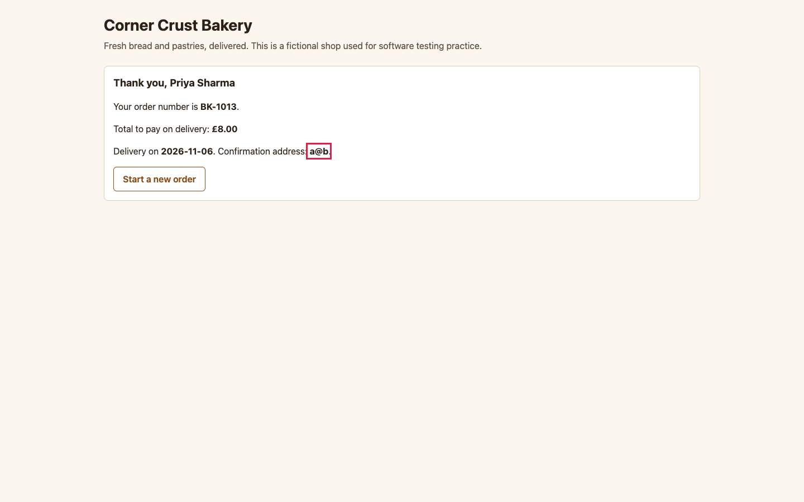

# BUG-006: Email address without a domain suffix (a@b) is accepted

| Field | Value |
|---|---|
| ID | BUG-006 |
| Status | Confirmed (planted in the buggy build; not fixed) |
| Severity | S3 Minor |
| Priority (suggested) | P2 |
| Area | Email validation |
| Build | qa-report-kit 0.1.0, `app-buggy/` build (`npm run serve:buggy`, http://127.0.0.1:4173/) |
| Environment | Google Chrome 156.0.8078.76 (headless) on macOS; viewport 1440 x 900; locale en-GB, time zone Europe/London; browser clock and server date fixed to Wednesday 2026-11-04 |
| Found by | Regression case TC-040 failed on the buggy build, then reproduced by hand-written steps in a script (3 of 3 attempts) |
| Reproducibility | 3 of 3 attempts, each in a fresh browser context |

## Summary

`a@b` is accepted as an email address. So are `a@b.` and `a@b.c`, which lack a proper top-level domain.

## Preconditions

None. Steps that name a date assume today is Wednesday 04/11/2026 (the fixed date of the test environment); on another day, count dates from today instead.

## Steps to reproduce

1. Open the order page.
2. Add one **Sourdough loaf**.
3. Enter name `Priya Sharma` and delivery date `06/11/2026`.
4. In **Email** enter `a@b`.
5. Press **Place order**.

## Expected result

"Enter a valid email address, like name@example.com." appears under Email, the field is marked invalid and no order is created (rule R-7).

## Actual result

The order is placed and the confirmation reads **Confirmation address: a@b**.

## Evidence

*Confirmation showing the address a@b (outlined).*

Red outlines were added to the screenshot by the capture script (`npm run evidence`) to point at the problem; the app does not draw them.

## Impact

Confirmations to an address like this can never arrive, so the customer has no record and the shop cannot contact them about a delivery problem. It happens mostly through typing mistakes.

## Notes

Addresses without an `@`, with spaces, or with an empty part before or after the `@` are still rejected. Only the requirement for a dot and a suffix of two or more characters is missing. Related test cases: TC-040.
