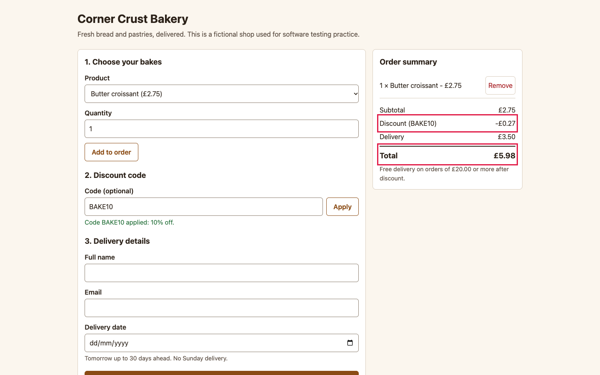

# BUG-007: Half-penny discount is rounded down, so the total is 1p too high

| Field | Value |
|---|---|
| ID | BUG-007 |
| Status | Confirmed (planted in the buggy build; not fixed) |
| Severity | S3 Minor |
| Priority (suggested) | P2 |
| Area | Pricing and discount codes |
| Build | qa-report-kit 0.1.0, `app-buggy/` build (`npm run serve:buggy`, http://127.0.0.1:4173/) |
| Environment | Google Chrome 156.0.8078.76 (headless) on macOS; viewport 1440 x 900; locale en-GB, time zone Europe/London; browser clock and server date fixed to Wednesday 2026-11-04 |
| Found by | Regression case TC-012 failed on the buggy build, then reproduced by hand-written steps in a script (3 of 3 attempts) |
| Reproducibility | 3 of 3 attempts, each in a fresh browser context |

## Summary

When a discount comes to exactly half a penny, the discount is cut off instead of rounded up, so the customer pays one penny more than the rule says.

## Preconditions

None.

## Steps to reproduce

1. Open the order page.
2. Choose **Butter croissant** (2.75), quantity `1`, press **Add to order**.
3. Enter `BAKE10` and press **Apply**.
4. Read the **Discount** and **Total** lines.

## Expected result

10% of 2.75 is 0.275, which rounds half up to 0.28 (rule R-4). Discount -0.28, total 2.47 + 3.50 = **5.97**.

## Actual result

Discount **-£0.27** and total **£5.98**.

## Evidence

*Summary for one croissant with BAKE10: discount -0.27 and total 5.98 (outlined). The expected figures are -0.28 and 5.97.*

Red outlines were added to the screenshot by the capture script (`npm run evidence`) to point at the problem; the app does not draw them.

## Impact

One penny too much on every order whose discount ends in a half penny (any subtotal that is an odd multiple of 5p with BAKE10, and others with LOAF5). The amount is small, but it is a wrong charge, which makes it a trust and sometimes a legal problem for a shop.

## Notes

Orders whose discount is a whole number of pence are not affected. The unit test "rounds a half-penny discount up" fails on the buggy rule as well. Another half-penny case: 3 cinnamon buns with BAKE10 (0.975 should round to 0.98). Related test cases: TC-012.
