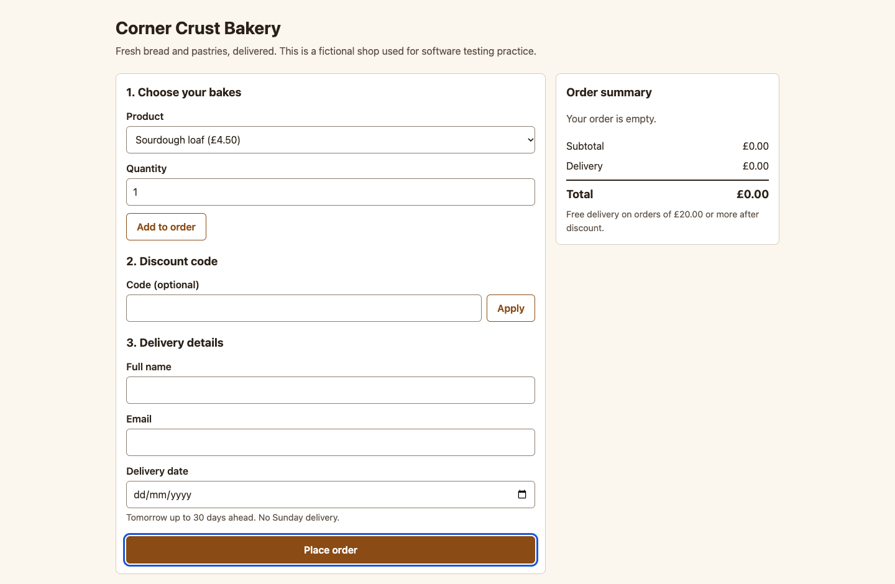

# BUG-008: Keyboard focus jumps to Place order first when Tab is pressed

| Field | Value |
|---|---|
| ID | BUG-008 |
| Status | Confirmed (planted in the buggy build; not fixed) |
| Severity | S3 Minor |
| Priority (suggested) | P2 |
| Area | Keyboard and accessibility |
| Build | qa-report-kit 0.1.0, `app-buggy/` build (`npm run serve:buggy`, http://127.0.0.1:4173/) |
| Environment | Google Chrome 156.0.8078.76 (headless) on macOS; viewport 1440 x 900; locale en-GB, time zone Europe/London; browser clock and server date fixed to Wednesday 2026-11-04 |
| Found by | Regression case TC-080, TC-081, TC-082 failed on the buggy build, then reproduced by hand-written steps in a script (3 of 3 attempts) |
| Reproducibility | 3 of 3 attempts, each in a fresh browser context |

## Summary

Pressing Tab on a fresh page moves focus to **Place order** at the bottom of the form instead of to the first field. The tab order no longer follows the reading order.

## Preconditions

None. Use the keyboard only.

## Steps to reproduce

1. Open the order page and do not click anything.
2. Press **Tab** once.
3. Note which control has the focus ring.
4. Keep pressing Tab and note the order of the other controls.

## Expected result

The first Tab stop is the **Product** list, then Quantity, Add to order, Code, Apply, Name, Email, Delivery date and finally Place order (rule R-11).

## Actual result

The first Tab stop is **Place order**. After it, focus goes to Product and continues in the normal order, ending on the date picker.

## Evidence

*Full page after one Tab press: the focus ring is on Place order at the bottom.*

Red outlines were added to the screenshot by the capture script (`npm run evidence`) to point at the problem; the app does not draw them.

## Impact

Keyboard and screen-reader users reach the submit button before they have filled anything in and may submit an empty form, or lose their place. It affects everyone who does not use a mouse, which is a legal accessibility requirement in many countries for shops.

## Notes

Cause is likely a positive `tabindex` on the button (a guess from the behaviour; the markup was not inspected during the test). Keyboard-only completion of the order fails as a result (TC-081). Related test cases: TC-080, TC-081, TC-082.
