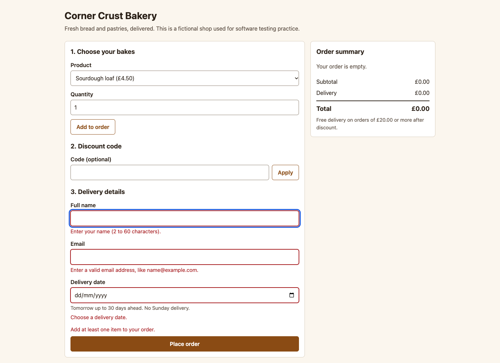
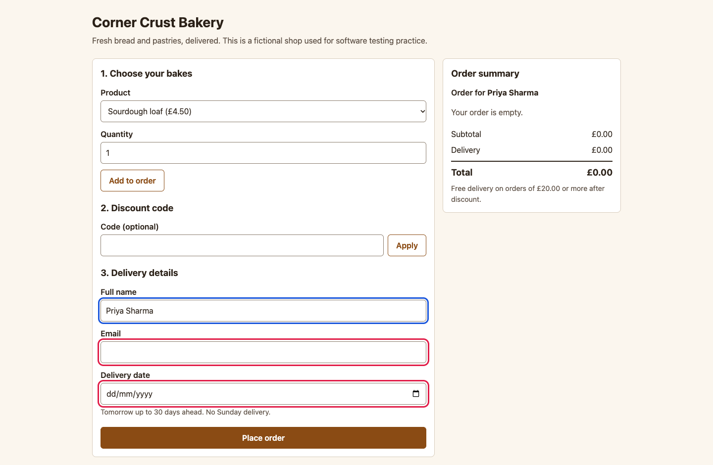

# BUG-009: Typing in one field removes the error messages of all other fields

| Field | Value |
|---|---|
| ID | BUG-009 |
| Status | Confirmed (planted in the buggy build; not fixed) |
| Severity | S4 Trivial |
| Priority (suggested) | P3 |
| Area | Error messages |
| Build | qa-report-kit 0.1.0, `app-buggy/` build (`npm run serve:buggy`, http://127.0.0.1:4173/) |
| Environment | Google Chrome 156.0.8078.76 (headless) on macOS; viewport 1440 x 900; locale en-GB, time zone Europe/London; browser clock and server date fixed to Wednesday 2026-11-04 |
| Found by | Regression case TC-051 failed on the buggy build, then reproduced by hand-written steps in a script (3 of 3 attempts) |
| Reproducibility | 3 of 3 attempts, each in a fresh browser context |

## Summary

After a failed submit, typing in one field clears the error messages under every field, including fields that are still empty or invalid.

## Preconditions

None.

## Steps to reproduce

1. Open the order page and press **Place order** without entering anything. Messages appear for the order, name, email and delivery date.
2. Click in **Full name** and type `Priya Sharma`.
3. Look at the messages under Email and Delivery date.

## Expected result

Only the name message disappears. The email and date messages stay until those fields are edited (rule R-10).

## Actual result

All messages vanish, including the ones under Email and Delivery date, which are still empty. The fields lose their red border too. The problems are not fixed, but nothing says so until the next submit.

## Evidence

*After the empty submit: the messages are shown.*

*After typing a name: the empty Email and Delivery date fields (outlined) have no message and no red border.*

Red outlines were added to the screenshot by the capture script (`npm run evidence`) to point at the problem; the app does not draw them.

## Impact

Users who fix fields one by one lose track of what is still wrong, then fail again at the next submit. Annoying rather than damaging.

## Notes

The fields themselves keep failing validation on the next submit, so no invalid order gets through. Related test cases: TC-051.
