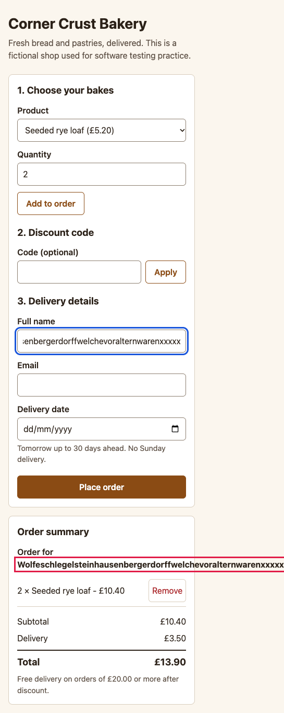

# BUG-010: A long name without spaces runs out of the order summary and makes the page scroll sideways at 390 px

| Field | Value |
|---|---|
| ID | BUG-010 |
| Status | Confirmed (planted in the buggy build; not fixed) |
| Severity | S3 Minor |
| Priority (suggested) | P2 |
| Area | Layout (phone width) |
| Build | qa-report-kit 0.1.0, `app-buggy/` build (`npm run serve:buggy`, http://127.0.0.1:4173/) |
| Environment | Google Chrome 156.0.8078.76 (headless) on macOS; viewport 390 x 844; locale en-GB, time zone Europe/London; browser clock and server date fixed to Wednesday 2026-11-04 |
| Found by | Regression case TC-091, TC-092 failed on the buggy build, then reproduced by hand-written steps in a script (3 of 3 attempts) |
| Reproducibility | 3 of 3 attempts, each in a fresh browser context |

## Summary

A 60-character name with no spaces is shown on one line in the order summary and sticks out of the card. On a phone the page then scrolls sideways.

## Preconditions

Window or device width 390 px.

## Steps to reproduce

1. Open the order page at a width of 390 px.
2. Add two **Seeded rye loaf**.
3. In **Full name** enter `Wolfeschlegelsteinhausenbergerdorffwelchevoralternwarenxxxxx` (60 letters, no spaces).
4. Scroll down to **Order summary** and look at the line "Order for ...".
5. Try to scroll the page sideways.

## Expected result

The long name wraps inside the card and the page does not scroll sideways (rule R-12). Nothing sticks out of its box.

## Actual result

The name stays on one line and runs past the right edge of the card; the page is wider than the window (see numbers below) and can be scrolled sideways. The same happens at 768 and 1440 px, where the name pokes out of the side column. Measured on the page: content width 545 px in a 390 px window.

## Evidence

*Full-page screenshot at 390 px. The name (outlined) runs past the edge of the summary card; the image is wider than the 390 px window.*

Red outlines were added to the screenshot by the capture script (`npm run evidence`) to point at the problem; the app does not draw them.

## Impact

Rare in real life (long names with no break), but when it happens on a phone the layout is broken for that user, and the confirmation page may be affected too. Workaround: none for the user.

## Notes

The name field itself and the confirmation page still wrap correctly; only the summary line is affected. Related test cases: TC-091, TC-092.
